<picture>
  <source media="(max-width: 600px)" srcset="dhara-banner-mobile.svg">
  
</picture>

# Hi, I'm Dhara.

I'm a **Computing Science student at Simon Fraser University**, an Android developer, and **Co-founder & Software Developer at [TechAlong Labs](https://www.techalonglabs.com/)**, where I lead our development team. I build mobile apps, explore how machine learning works under the hood, and care about making useful software understandable to the people using it.

**Open to internships in Android, software development, and applied ML.**

[LinkedIn](https://www.linkedin.com/in/dhara-patel-234516236/) · [Email](mailto:ddp7@sfu.ca) · [Browse my repositories](https://github.com/dhara-patel-2354?tab=repositories)

## Experience

### [TechAlong Labs](https://www.techalonglabs.com/)

**Co-founder & Software Developer · May 2026–Present**

I co-founded TechAlong Labs, an incorporated nonprofit building technology to help people experiencing gender-based violence find support. I lead our development team on **[OTAF](https://github.com/dhara-patel-2354/OTAF)**, a platform we're building to bring together transition-house availability and service information in BC.

- Work with transition-house staff and social service organizations to understand their needs and plan features based on their feedback.
- Built public and staff dashboards in **React**, using **React Router** for navigation and the **Context API** to share state between views.
- Added staff tools to update availability, record intake notes, and tag services and populations served, with a confirmation step before status changes.

We're developing OTAF through **SFU's Charles Chang Institute incubator**, with feedback from transition-house staff and the Salvation Army.

**Current stage:** a frontend prototype using sample data. Live availability integration and a support chatbot using trauma-informed language are planned.

## My Projects

### [MyMaps — A personal map journal](https://github.com/dhara-patel-2354/My-maps)

**Kotlin · Android · Google Maps SDK · Firebase Authentication · Cloud Firestore**

Built an Android app that lets users organize meaningful places into saved map collections. Integrated sign-in and cloud storage so users can save maps, revisit their notes, and add or remove pins later.

**Engineering details:** eight marker colours, automatic timestamps, custom map info windows, and a RecyclerView for browsing saved collections.

### MNIST — A neural network built with NumPy

**Python · NumPy · Matplotlib**

Implemented a two-layer neural network to classify handwritten digits **0–9**, including forward propagation, ReLU, softmax, and backpropagation without an ML framework. Added weight saving and loading so trained parameters can be reused between runs.

### PyCar — Computer vision meets physical movement

**Python · Raspberry Pi · OpenCV · Sensors and motor control**

Built a robot car that follows a line and avoids obstacles, connecting camera and sensor input to motor-control decisions. This project brought perception and control together in a physical system.

### More things I've built

| Project | What it does |
| --- | --- |
| **Clothifyy** | HackML virtual try-on prototype using the Gemini API to explore garment visualization from product information and uploaded images. |
| **Foursquare place discovery** | Kotlin Android app using Retrofit and the Foursquare Places API to search by query and location and display place details. |
| **[DineEase](https://github.com/dhara-patel-2354/-DineEase-Online-Restaurant-Ordering-System)** | Restaurant-ordering prototype with PHP/MySQL account registration and login, JavaScript cart controls, and a simulated checkout. |
| **ChatWave** | React and Node.js/Express messaging project with multiple conversations and message history. |

## My toolkit

| Area | Technologies I've used |
| --- | --- |
| **Languages** | Kotlin, Java, Python, JavaScript, C, C++ |
| **Android** | Android SDK, Google Maps SDK, RecyclerView, Retrofit, Android Studio |
| **ML & computer vision** | NumPy, Matplotlib, OpenCV, Raspberry Pi |
| **Web** | React, React Router, Tailwind CSS, Node.js, Express, PHP |
| **Data & tools** | Firebase Authentication, Cloud Firestore, MySQL, Git, Docker, Linux, Postman, Vercel |

Previously: **Diploma in Computer Studies, Langara College · Dean's Honour Roll.**

Outside of building: swimming, fitness, meditation, and gaming.

**Let's build something useful.** [ddp7@sfu.ca](mailto:ddp7@sfu.ca)
